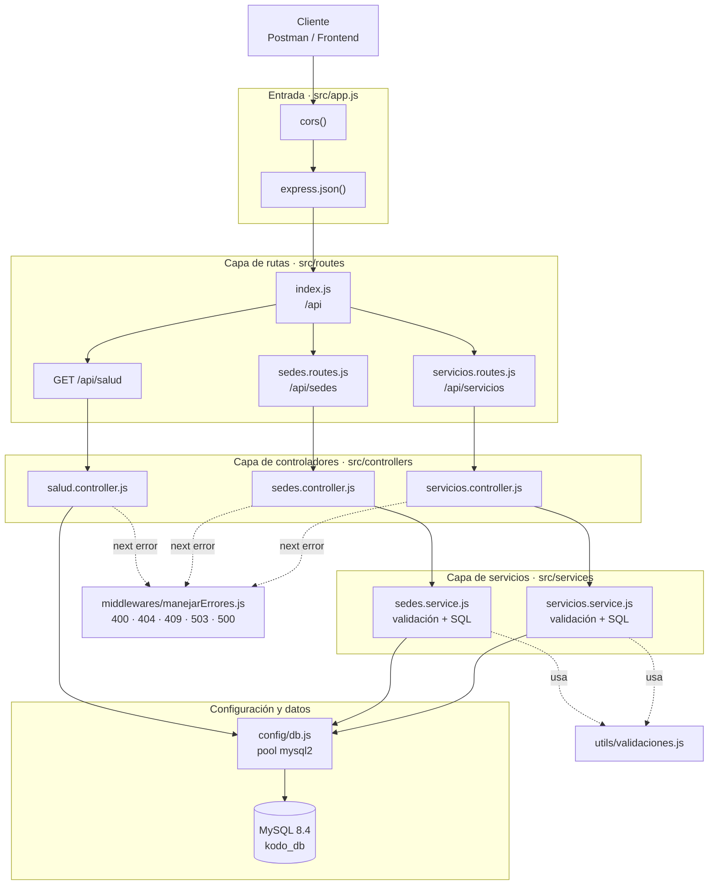
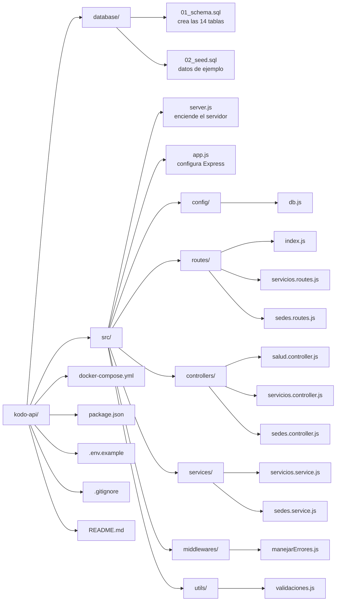
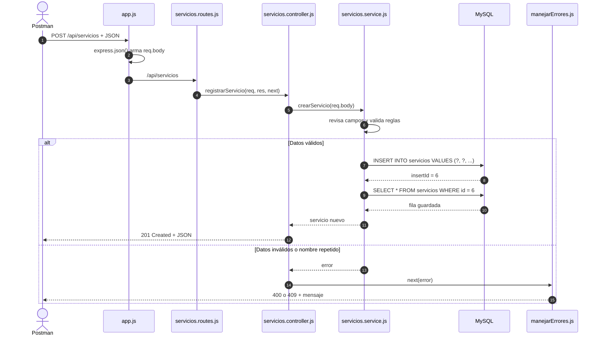
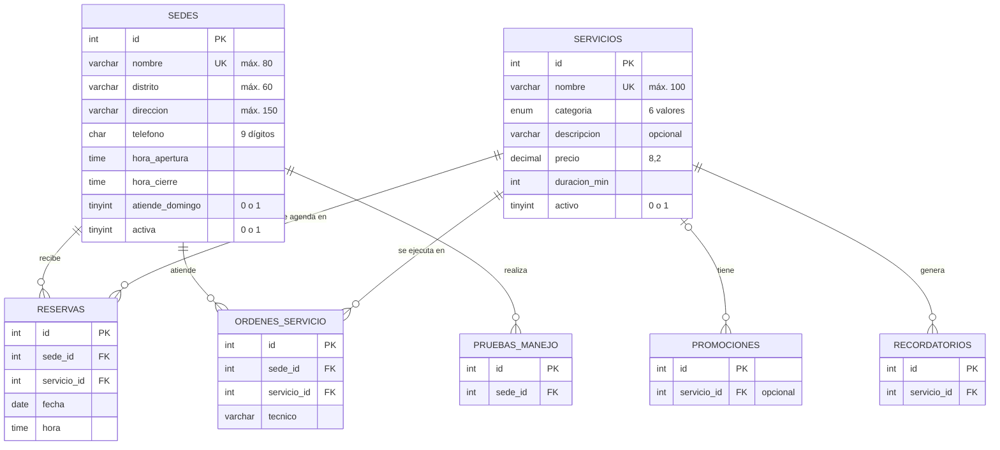
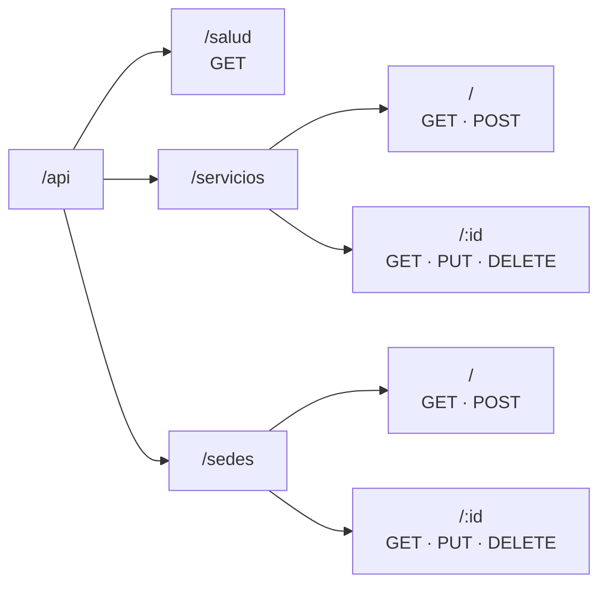
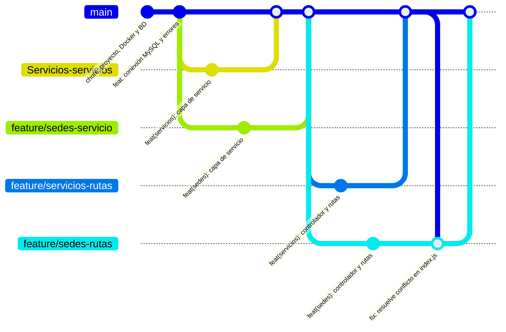

# Kodo Motors API · Sedes y Servicios

API REST con persistencia en MySQL para gestionar los **locales (sedes)** y el **catálogo de servicios** del taller Kodo Motors. Está construida con Node.js y Express y organizada por capas. Es la Evidencia Evaluativa 2 del curso Fundamentos de Desarrollo Back-End (UCAL).


## Contenido

1. [Empresa y solución](#1-empresa-y-solución)
2. [Integrantes](#2-integrantes)
3. [Tecnologías](#3-tecnologías)
4. [Arquitectura por capas](#4-arquitectura-por-capas)
5. [Estructura de carpetas](#5-estructura-de-carpetas)
6. [Recorrido de una petición](#6-recorrido-de-una-petición)
7. [Base de datos](#7-base-de-datos)
8. [Instalación](#8-instalación)
9. [Ejecución](#9-ejecución)
10. [Endpoints](#10-endpoints)
11. [Trabajo colaborativo en GitHub](#11-trabajo-colaborativo-en-github)
12. [Problemas resueltos durante la integración](#12-problemas-resueltos-durante-la-integración)

---

## 1. Empresa y solución

**Empresa aliada:** Kodo Motors, taller automotriz multimarca con 7 locales en Lima y Arequipa.

**Problema:** las citas, las órdenes de trabajo y las reservas dependen de saber en qué sede se atiende, en qué horario y qué servicio se hace a qué precio. Sin un catálogo único, cada sede escribe los trabajos como texto libre y los precios no son coherentes.

**Solución:** una API que registra, consulta, actualiza y elimina sedes y servicios en MySQL. Valida las reglas del negocio antes de guardar y protege los registros que ya están en uso por reservas u órdenes.

| Módulo | Qué gestiona | Ruta base |
| --- | --- | --- |
| Servicios | Catálogo de trabajos del taller: categoría, precio y duración | `/api/servicios` |
| Sedes | Locales de Kodo: distrito, dirección, teléfono y horario | `/api/sedes` |

## 2. Integrantes

<!-- Completar los apellidos y confirmar el nombre real de cada rama -->

| Integrante | Parte del proyecto | Archivos | Rama |
| --- | --- | --- | --- |
| Felipe Reyes Ingunza | Base del proyecto, Docker, base de datos, conexión, manejo de errores | `package.json`, `docker-compose.yml`, `database/`, `src/app.js`, `src/server.js`, `src/config/`, `src/utils/`, `src/middlewares/`, `src/routes/index.js` | `main` |
| Rachel | Lógica de negocio de Servicios | `src/services/servicios.service.js` | `Servicios-servicios` |
| Anthony | Controlador y rutas de Servicios | `src/controllers/servicios.controller.js`, `src/routes/servicios.routes.js` | `feature/servicios-rutas` |
| Omar | Lógica de negocio de Sedes | `src/services/sedes.service.js` | `feature/sedes-servicio` |
| Alejandro | Controlador y rutas de Sedes | `src/controllers/sedes.controller.js`, `src/routes/sedes.routes.js` | `feature/sedes-rutas` |

## 3. Tecnologías

| Tecnología | Versión | Para qué se usa |
| --- | --- | --- |
| Node.js | 18 o superior | Entorno que ejecuta JavaScript en el servidor |
| Express | 5.2.1 | Servidor HTTP, rutas y middlewares |
| mysql2 | 3.24.4 | Conexión a MySQL con pool y consultas preparadas |
| dotenv | 17.4.2 | Lee las variables del archivo `.env` |
| cors | 2.8.5 | Permite que un frontend en otra dirección consuma la API |
| nodemon | 3.1.14 | Reinicia el servidor al guardar cambios (desarrollo) |
| MySQL | 8.4 (Docker) | Base de datos relacional |
| Adminer | Docker | Visor web de la base de datos |
| Docker Compose | — | Levanta MySQL y Adminer con un solo comando |
| Postman | — | Pruebas de los endpoints |
| Git y GitHub | — | Control de versiones y trabajo en equipo |

## 4. Arquitectura por capas

Cada capa tiene una sola responsabilidad. La petición baja de arriba hacia abajo y la respuesta sube por el mismo camino. Si algo falla en cualquier capa, el error salta al middleware de errores, que responde con el código HTTP correcto.



| Capa | Responsabilidad | Lo que NO hace |
| --- | --- | --- |
| Rutas | Asocia cada método y URL con una función del controlador | No lee datos ni responde |
| Controladores | Lee `req.params`, `req.query` y `req.body`, llama al servicio y responde con `res.status().json()` | No valida reglas ni toca la base de datos |
| Servicios | Valida los datos, aplica las reglas del negocio y ejecuta el SQL | No conoce `req` ni `res` |
| Configuración | Crea el pool de conexiones a MySQL | — |
| Middleware de errores | Traduce cualquier error a un código HTTP y un mensaje claro | — |

## 5. Estructura de carpetas



La misma estructura en texto:

```text
kodo-api/
├── database/
│   ├── 01_schema.sql          # crea la base kodo_db y sus tablas
│   └── 02_seed.sql            # datos de ejemplo (3 sedes, 5 servicios…)
├── src/
│   ├── server.js              # archivo principal: carga .env, prueba MySQL y abre el puerto
│   ├── app.js                 # middlewares, rutas y manejo de errores
│   ├── config/
│   │   └── db.js              # pool de conexiones a MySQL
│   ├── routes/
│   │   ├── index.js           # monta todo bajo /api
│   │   ├── servicios.routes.js
│   │   └── sedes.routes.js
│   ├── controllers/
│   │   ├── salud.controller.js
│   │   ├── servicios.controller.js
│   │   └── sedes.controller.js
│   ├── services/
│   │   ├── servicios.service.js
│   │   └── sedes.service.js
│   ├── middlewares/
│   │   └── manejarErrores.js  # 404 de rutas y errores en un solo lugar
│   └── utils/
│       └── validaciones.js    # funciones de apoyo compartidas
├── docker-compose.yml         # MySQL 8.4 + Adminer
├── package.json
├── .env.example               # plantilla de variables (el .env real no se sube)
└── .gitignore
```

## 6. Recorrido de una petición

Ejemplo: registrar un servicio nuevo con `POST /api/servicios`.



## 7. Base de datos

La base `kodo_db` es el modelo común de la clase: 14 tablas. Este equipo trabaja **sedes** y **servicios**. Varias tablas de otros módulos apuntan a ellas con llaves foráneas; por eso una sede o un servicio que ya tiene reservas u órdenes no se puede eliminar.



**Categorías permitidas de servicio:** `mantenimiento`, `diagnostico`, `frenos`, `neumaticos`, `electrico`, `planchado_pintura`.

### Cómo crear la base de datos

**Opción A · con Docker (recomendada).** Los archivos de `database/` se ejecutan solos la primera vez que se levanta el contenedor, en orden alfabético.

```bash
docker compose up -d
```

| Servicio | Dirección | Usuario | Clave |
| --- | --- | --- | --- |
| MySQL | `localhost:3307` (base `kodo_db`) | `kodo` | `kodo123` |
| Adminer | `http://localhost:8081` (servidor: `mysql`) | `kodo` | `kodo123` |

MySQL usa el puerto **3307** en tu máquina para no chocar con un MySQL que ya tengas instalado en el 3306.

**Opción B · sin Docker.** Abrir MySQL Workbench, ejecutar `database/01_schema.sql` completo y luego `database/02_seed.sql`. Después, ajustar `DB_PORT` (normalmente 3306), `DB_USER` y `DB_PASSWORD` en el `.env`.

**Volver a los datos de ejemplo** (borra todo lo creado en pruebas):

```bash
docker compose down -v
docker compose up -d
```

## 8. Instalación

Requisitos: Node.js 18 o superior, Docker Desktop y Git.

```bash
# 1. Clonar el repositorio
git clone https://github.com/USUARIO/kodo-api.git
cd kodo-api

# 2. Crear el archivo de variables a partir de la plantilla
cp .env.example .env          # Windows (CMD): copy .env.example .env

# 3. Instalar dependencias
npm install

# 4. Levantar la base de datos
docker compose up -d
```

Variables del `.env`:

| Variable | Valor por defecto | Para qué sirve |
| --- | --- | --- |
| `PORT` | `4000` | Puerto de la API |
| `CORS_ORIGIN` | `http://localhost:3000` | Dirección del frontend que puede consumir la API |
| `DB_HOST` | `localhost` | Servidor de MySQL |
| `DB_PORT` | `3307` | Puerto de MySQL |
| `DB_USER` / `DB_PASSWORD` | `kodo` / `kodo123` | Usuario de la base de datos |
| `DB_NAME` | `kodo_db` | Nombre de la base |
| `MYSQL_ROOT_PASSWORD` | `root123` | Clave de root del contenedor |

## 9. Ejecución

```bash
npm run dev
```

Si todo está bien, la terminal muestra:

```text
✔ Conectado a MySQL 8.4.x · base de datos: kodo_db
✔ API de Kodo Motors en http://localhost:4000
```

Si aparece `No se pudo conectar a MySQL`, Docker no está levantado o falta el `.env`.

| Comando | Qué hace |
| --- | --- |
| `npm run dev` | Inicia la API con nodemon (se reinicia al guardar) |
| `npm start` | Inicia la API con Node, sin reinicio automático |
| `npm run bd:levantar` | `docker compose up -d` |
| `npm run bd:detener` | `docker compose down` |
| `npm run bd:reiniciar` | Borra los datos y vuelve a los de ejemplo |

## 10. Endpoints

URL base: `http://localhost:4000`

### Jerarquía de rutas



### General

| Método | Ruta | Descripción | Éxito |
| --- | --- | --- | --- |
| GET | `/` | Información de la API | 200 |
| GET | `/api/salud` | Comprueba la conexión con MySQL | 200 |

### Servicios

| Método | Ruta | Descripción | Éxito | Errores |
| --- | --- | --- | --- | --- |
| GET | `/api/servicios` | Lista todos. Filtros: `?categoria=frenos`, `?activo=true` | 200 | 400 |
| GET | `/api/servicios/:id` | Consulta uno | 200 | 400, 404 |
| POST | `/api/servicios` | Registra uno nuevo | 201 | 400, 409 |
| PUT | `/api/servicios/:id` | Actualiza; se puede enviar solo lo que cambia | 200 | 400, 404, 409 |
| DELETE | `/api/servicios/:id` | Elimina | 200 | 400, 404, 409 |

Body de ejemplo (POST):

```json
{
  "nombre": "Cambio de refrigerante",
  "categoria": "mantenimiento",
  "descripcion": "Refrigerante original Mazda",
  "precio": 95.50,
  "duracion_min": 40
}
```

| Campo | Obligatorio | Regla |
| --- | --- | --- |
| `nombre` | Sí | Texto de hasta 100 caracteres, único |
| `categoria` | Sí | Una de las 6 categorías permitidas |
| `descripcion` | No | Texto de hasta 255 caracteres |
| `precio` | Sí | Mayor que 0 y hasta 999999.99 |
| `duracion_min` | Sí | Entero mayor que 0 |
| `activo` | No | `true` o `false` (por defecto `true`) |

### Sedes

| Método | Ruta | Descripción | Éxito | Errores |
| --- | --- | --- | --- | --- |
| GET | `/api/sedes` | Lista todas. Filtros: `?distrito=Surquillo`, `?activa=true` | 200 | 400 |
| GET | `/api/sedes/:id` | Consulta una | 200 | 400, 404 |
| POST | `/api/sedes` | Registra una nueva | 201 | 400, 409 |
| PUT | `/api/sedes/:id` | Actualiza; se puede enviar solo lo que cambia | 200 | 400, 404, 409 |
| DELETE | `/api/sedes/:id` | Elimina | 200 | 400, 404, 409 |

Body de ejemplo (POST):

```json
{
  "nombre": "Kodo Miraflores",
  "distrito": "Miraflores",
  "direccion": "Av. Arequipa 4500",
  "telefono": "014567890",
  "hora_apertura": "08:00",
  "hora_cierre": "19:00",
  "atiende_domingo": true
}
```

| Campo | Obligatorio | Regla |
| --- | --- | --- |
| `nombre` | Sí | Texto de hasta 80 caracteres, único |
| `distrito` | Sí | Texto de hasta 60 caracteres |
| `direccion` | Sí | Texto de hasta 150 caracteres |
| `telefono` | Sí | Texto de exactamente 9 dígitos (entre comillas, para no perder el 0 inicial) |
| `hora_apertura` | Sí | Formato `HH:MM`, menor que `hora_cierre` |
| `hora_cierre` | Sí | Formato `HH:MM` |
| `atiende_domingo` | No | `true` o `false` (por defecto `false`) |
| `activa` | No | `true` o `false` (por defecto `true`) |

### Formato de las respuestas

Respuesta exitosa:

```json
{
  "ok": true,
  "mensaje": "Servicio registrado correctamente",
  "datos": { "id": 6, "nombre": "Cambio de refrigerante", "precio": 95.5, "activo": true }
}
```

Respuesta de error:

```json
{
  "ok": false,
  "mensaje": "Datos del servicio no válidos",
  "detalles": [
    "categoria debe ser una de: mantenimiento, diagnostico, frenos, neumaticos, electrico, planchado_pintura",
    "precio debe ser un número mayor que 0 y menor o igual a 999999.99"
  ]
}
```

### Códigos de estado

| Código | Cuándo se usa |
| --- | --- |
| 200 OK | Consulta, actualización o eliminación correcta |
| 201 Created | Registro nuevo creado |
| 400 Bad Request | Datos inválidos, JSON mal escrito, campo no permitido o id no numérico |
| 404 Not Found | El id no existe o la ruta no existe |
| 409 Conflict | Nombre repetido, o registro en uso por reservas u órdenes |
| 503 Service Unavailable | No hay conexión con MySQL |
| 500 Internal Server Error | Error inesperado (se registra en la terminal) |

## 11. Trabajo colaborativo en GitHub

Felipe subió la base del proyecto a `main`. Cada integrante creó su propia rama, subió su parte y la integró con un pull request que Felipe revisó y aprobó. El orden respetó las dependencias entre capas: primero los servicios (lógica), luego los controladores y rutas que los usan.



| Paso | Quién | Qué se integró |
| --- | --- | --- |
| 1 | Felipe | Base del proyecto en `main` |
| 2 | Rachel y Omar | Capas de servicio de Servicios y Sedes (en paralelo) |
| 3 | Anthony y Alejandro | Controladores y rutas (en paralelo) |
| 4 | Alejandro | Resolución del conflicto en `src/routes/index.js` |

## 12. Problemas resueltos durante la integración

| Problema u observación | Causa | Solución |
| --- | --- | --- |
| Conflicto de merge en `src/routes/index.js` | Anthony y Alejandro agregaron sus rutas en las mismas líneas del archivo | Se trajo `main` a la rama, se dejaron las dos líneas (servicios y sedes), se borraron las marcas `<<<<<<<`, `=======` y `>>>>>>>`, y se hizo commit y push |
| Las tildes se guardaban mal ("Diagnóstico") | El cliente de MySQL importaba el script con otra codificación | Se agregó `SET NAMES utf8mb4;` al inicio de `02_seed.sql` |
| El precio llegaba como texto (`"380.00"`) | mysql2 devuelve DECIMAL como texto por defecto | Se activó `decimalNumbers: true` en el pool |
| `activo` y `activa` llegaban como 1 y 0 | MySQL guarda TINYINT(1) como número | Se agregó un `typeCast` en `db.js` que los convierte a `true` y `false` |
| MySQL rechaza borrar una sede o un servicio con reservas u órdenes | La llave foránea protege los registros en uso | Se captura ese error y se responde 409 con la sugerencia de desactivarlo con PUT |
| El teléfono perdía el 0 inicial | Enviado como número, `014567890` se vuelve `14567890` | El teléfono se exige como texto de 9 dígitos |
| La carpeta `src/services` no aparecía en el repo | Git no guarda carpetas vacías | Se creó al subir el primer archivo con su ruta completa |
| Riesgo de subir las claves de la base de datos | El `.env` tiene usuario y contraseña | `.env` está en `.gitignore`; se sube solo `.env.example` |
| MySQL de Docker chocaba con un MySQL local | Ambos usaban el puerto 3306 | El contenedor se publica en el puerto 3307 |
